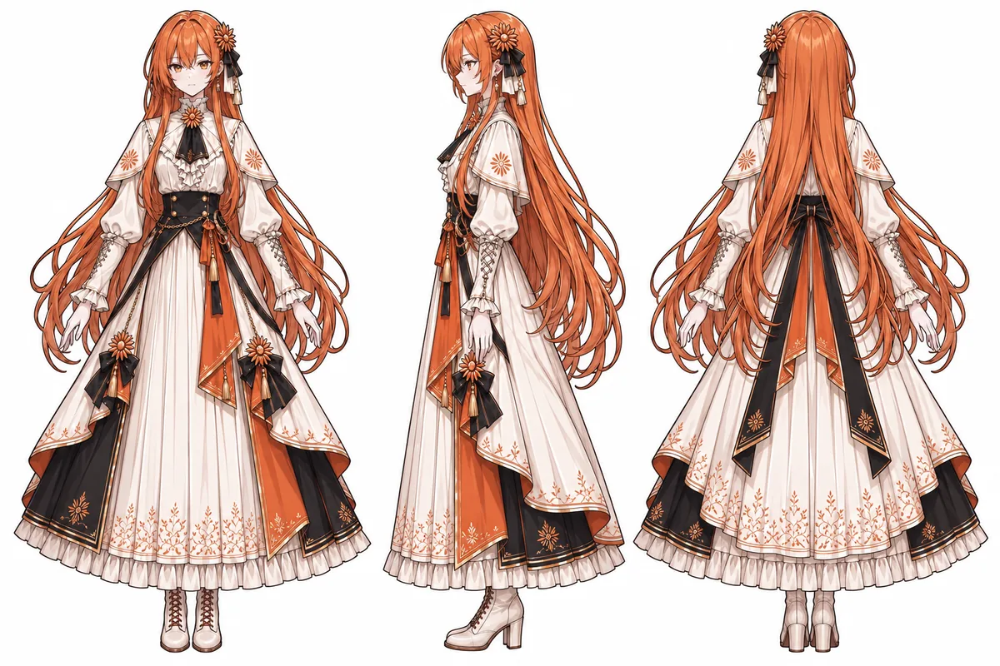

# Claude-chan Gallery

[中文](README.md) | **English**

ChatGPT wouldn't refund my accidental Pro subscription, so I'm spending the whole quota on pictures of Claude-chan.

There are currently **853** pictures, all generated with ChatGPT and released under CC0: download, repost, edit or use them commercially, with no credit or permission needed.

## Highlights

<table>
<tr><td align="center" width="33%"> 两头都有人接住了</td><td align="center" width="33%"> 把一颗星放回书库</td><td align="center" width="33%"> 空缆车驶入云海</td></tr>
<tr><td align="center" width="33%"> 清晨的第一层豆皮</td><td align="center" width="33%"> 阿姨把口令晚喊了一拍</td><td align="center" width="33%"> 按一下就站起来的山</td></tr>
</table>

## All pictures

In the order they were generated, 100 per page:

- [Page 1](gallery/page-01.md) (1–100)
- [Page 2](gallery/page-02.md) (101–200)
- [Page 3](gallery/page-03.md) (201–300)
- [Page 4](gallery/page-04.md) (301–400)
- [Page 5](gallery/page-05.md) (401–500)
- [Page 6](gallery/page-06.md) (501–600)
- [Page 7](gallery/page-07.md) (601–700)
- [Page 8](gallery/page-08.md) (701–800)
- [Page 9](gallery/page-09.md) (801–853)

## Download

- **One picture**: click a thumbnail to open the original, then use the download button at the top right.
- **Everything**: click the green Code button at the top of the page, then Download ZIP. The originals are PNG files, so the archive is several GB.
- **With git**: `git clone --depth 1 https://github.com/zengas7/claude-chan-gallery.git`

Originals are in [`images/`](images/), thumbnails in [`thumbs/`](thumbs/).

## About the pictures

Every picture uses the [character reference sheet](设定/角色三视图.png) as its only model: the same face, the same long ochre-orange hair and the same outfit, while the setting, pose, framing, weather and art style are combined at random and no combination is reused. The full generation rules (in Chinese) are in [设定/出图说明.md](设定/出图说明.md), if you want to keep drawing her yourself.

Each file name is the picture's title, in Chinese.

## License

[CC0 1.0](LICENSE): all rights waived; the work is in the public domain.

This is fan art and is not affiliated with Anthropic or OpenAI.
