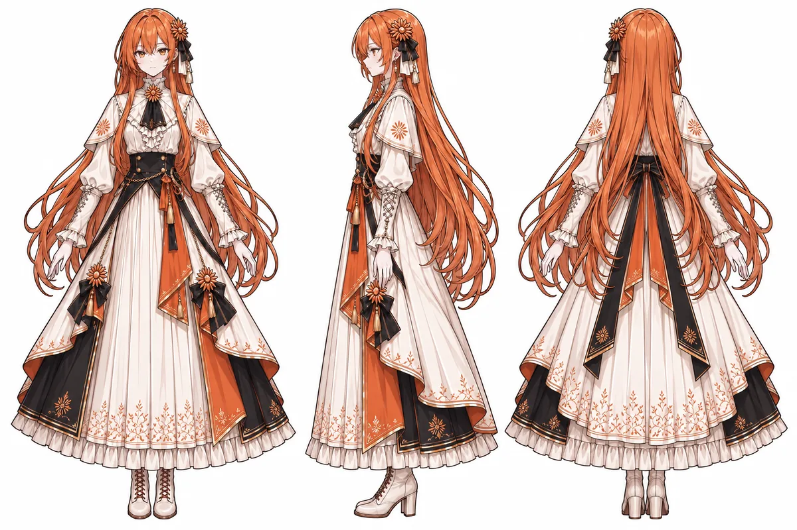

# Claude 娘美图集

**中文** | [English](README.en.md)

GPT Pro 不给退款，那就把额度全蹬成 Claude 娘的美图。

目前共 **853** 张，全部由 ChatGPT 生成，以 CC0 协议开源：随便下载、转载、修改、商用，不用署名，也不用打招呼。

## 精选

<table>
<tr><td align="center" width="33%"> 两头都有人接住了</td><td align="center" width="33%"> 把一颗星放回书库</td><td align="center" width="33%"> 空缆车驶入云海</td></tr>
<tr><td align="center" width="33%"> 清晨的第一层豆皮</td><td align="center" width="33%"> 阿姨把口令晚喊了一拍</td><td align="center" width="33%"> 按一下就站起来的山</td></tr>
</table>

## 全部图片

按生成时间排列，每页 100 张：

- [第 1 页](gallery/page-01.md)（第 1–100 张）
- [第 2 页](gallery/page-02.md)（第 101–200 张）
- [第 3 页](gallery/page-03.md)（第 201–300 张）
- [第 4 页](gallery/page-04.md)（第 301–400 张）
- [第 5 页](gallery/page-05.md)（第 401–500 张）
- [第 6 页](gallery/page-06.md)（第 501–600 张）
- [第 7 页](gallery/page-07.md)（第 601–700 张）
- [第 8 页](gallery/page-08.md)（第 701–800 张）
- [第 9 页](gallery/page-09.md)（第 801–853 张）

## 下载

- **单张**：点缩略图打开原图，再点右上角的下载按钮。
- **全部**：点页面上方绿色的 Code 按钮 → Download ZIP。原图是 PNG，整包体积有好几个 GB。
- **用 git**：`git clone --depth 1 https://github.com/zengas7/claude-chan-gallery.git`

原图在 [`images/`](images/)，缩略图在 [`thumbs/`](thumbs/)。

## 关于这些图

每张图都以 [角色三视图](设定/角色三视图.png) 为唯一基准：同一张脸、同一头赭橙色长发、同一套衣服；场景、动作、镜头、天气和画风随机组合，用过的组合不再重复。完整的出图规则见 [设定/出图说明.md](设定/出图说明.md)，想自己接着画也可以照着用。

文件名就是图题。

## 许可

[CC0 1.0](LICENSE)：作者放弃全部权利，作品进入公有领域。

这是同人创作，与 Anthropic、OpenAI 官方无关。
