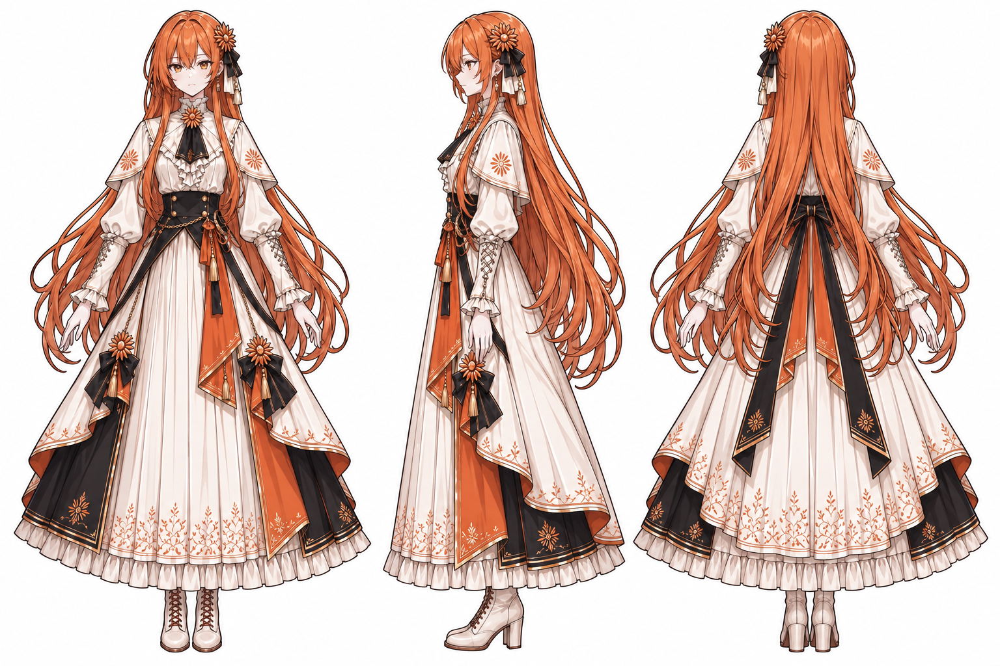

# 角色出图说明

## 固定角色

每次生成都以同目录的《角色三视图.png》为唯一角色基准。对照相应视角，保持脸型、五官、赭橙色长发、刘海与整体发型一致。花形发饰、蝴蝶结、垂饰的位置与样式，以及整套服装的剪裁、层次、配色、纹样和鞋靴，都按原图保留。即使场景、天气或画风改变，也始终是同一个角色，穿同一套衣服，梳同一个发型。

## 每张图如何选组合

除上述固定设定外，其余元素自由随机组合。以下是灵感示例，鼓励使用列表之外的想法。

| 维度 | 可选方向 |
| --- | --- |
| 场景 | 日常场所、城市、自然、幻想、科幻，室内外均可。也可以选退潮后的船坞、深夜的天文馆放映室等具体地点。 |
| 动作与姿态 | 站、坐、走、回头、伸手、打盹或工作。让姿态自然，视线跟随她正在做的事，避免反复站着看镜头。 |
| 表情情绪 | 平静、微笑、惊讶、困倦、认真、得意等，与当下情境相呼应。 |
| 镜头 | 全身、半身、特写、背影、俯拍、仰拍或广角带景。 |
| 时间与天气 | 清晨、正午、黄昏或深夜，自由搭配晴、雨、雪、雾等天气。 |
| 画风媒介 | 默认画风、水彩、厚涂、海报、胶片感等。 |

## 出图顺序与去重

1. 出图前，先与本对话里所有已用组合逐一比较。已经用过的组合永远不再使用。遇到相近的组合，至少更换两个维度。避免反复选用最常见的搭配。
2. 先用一行小字写出本次抽到的组合，按下方格式填写。表情并入动作，时段并入天气。
3. 写完这一行，再以三视图为参照生成图片。本次实际出图的组合计入本对话的已用记录。

*〈场景〉 / 〈动作与表情〉 / 〈镜头〉 / 〈时间与天气〉 / 〈画风〉*